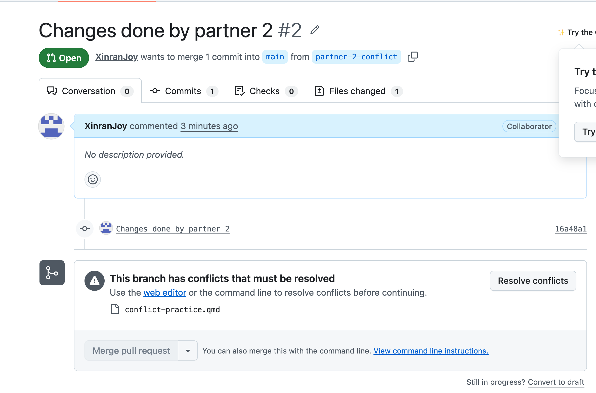
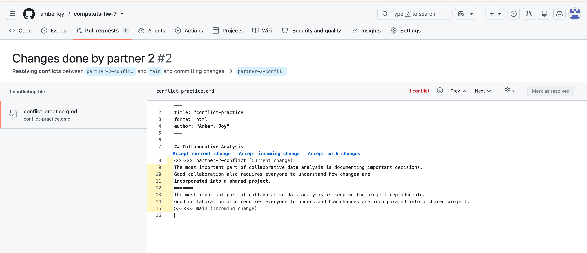
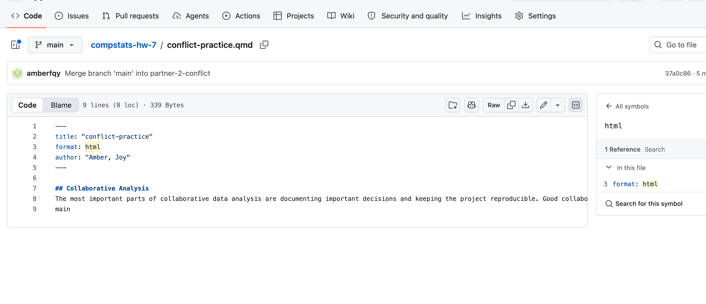

1. The merge conflict occurred because both partners modified the same part of the original file in different ways. Git could not automatically determine which version to keep since both of them are changing the same part. 

2. Since both branches were created from the same main branch, each partner made different changes to the same line, resulting in a merge conflict. Neither version automatically takes priority because both changes were made from the same original version. So, automatically decision making may result in lose of someone's contribution. 

3. To solve the conflict, we combined ideas from both versions (2 conflict branches) into one final sentence:

"The most important parts of collaborative data analysis are documenting important decisions and keeping the project reproducible."

This sentence preserves the key ideas.